# VeraScope
### AI-Powered Audio Transcription and Fact-Checking

**Automatic fact-checking of spoken audio and video.** Upload a recording. VeraScope
transcribes it, works out who spoke when, finds the check-worthy factual claims, searches
the web for evidence, and labels every claim. Each label shows how much trusted
evidence agrees or disagrees, and every source is shown next to it.

Capstone project. The code lives in this repository. Specs, phase notes and planning
documents are kept in the parent `capstone_project/` repo (see
[Development workflow](#development-workflow)).

---

## Contents

1. [What it does](#what-it-does)
2. [Project status](#project-status)
3. [Architecture at a glance](#architecture-at-a-glance)
4. [Repository layout](#repository-layout)
5. [Quick start](#quick-start)
6. [Run modes and flags](#run-modes-and-flags)
7. [Stage 1: speech to speaker-labelled lines](#stage-1-speech-to-speaker-labelled-lines)
8. [Stage 2: claims to verdicts (v2 pipeline)](#stage-2-claims-to-verdicts-v2-pipeline)
9. [Verdict labels](#verdict-labels)
10. [The Streamlit UI](#the-streamlit-ui)
11. [Record / replay cache](#record--replay-cache)
12. [Demo artifacts (no GPU, no API)](#demo-artifacts-no-gpu-no-api)
13. [Testing](#testing)
14. [GPU box (AWS)](#gpu-box-aws)
15. [Experiments (paper)](#experiments-paper)
16. [Free-tier budgets](#free-tier-budgets)
17. [Development workflow](#development-workflow)
18. [Known limitations](#known-limitations)
19. [Future scope](#future-scope)
20. [Data and licences](#data-and-licences)

---

## What it does

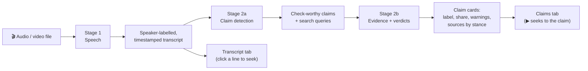

Example of a finished claim card:

> **Speaker 1** at 00:49: "First graders were doing 28 minutes of homework." —
> 🟢 **Mostly supported** (67% · 6 vs 3 points)
> ⚠️ Only one source took a side
> ⚠️ A highly trusted source disagrees
> **✅ Agree (2)** · **❌ Disagree (1)** · ➖ No side (5) · 🚫 Off-topic (1)

---

## Project status

| Stage | What | Status |
|---|---|---|
| Stage 1 (hosted) | Groq Whisper + pyannoteAI + wav2vec2 confidence | ✅ works; to be retired |
| Stage 1 (local, "Stage 3") | WhisperX + pyannote 3.1 on a GPU | ✅ works on AWS g5.xlarge (A10G). The 48:46 demo file takes 96.4 s, down from 289.9 s on a T4 |
| Stage 2 v1 | Single Tavily query, NLI, "any contradiction wins" | superseded by v2 |
| Stage 2 v2 ("Stage 4") | Search planning, trust points, best passage, tier-2 adjudicator, verdict v2 | ✅ wired into app (Phases 24–34) |
| UI claim cards | Labels, warnings, sources grouped by stance, seek buttons | 🟡 awaiting final human check (Phase 35) |
| Cited summary on click | 1–3 sentences, each re-checked by NLI | 🔲 planned (Phase 36) |
| E10 / E11 (AVeriTeC) | Benchmark of the v2 pipeline | ⏭️ skipped. The E10 data loader exists (`experiments/averitec.py`) |
| End-to-end on the GPU box | Demo artifact v2 | 🔲 planned (Phase 40) |

The offline test suite has 218 tests and passes (`scripts/check.sh`).

---

## Architecture at a glance

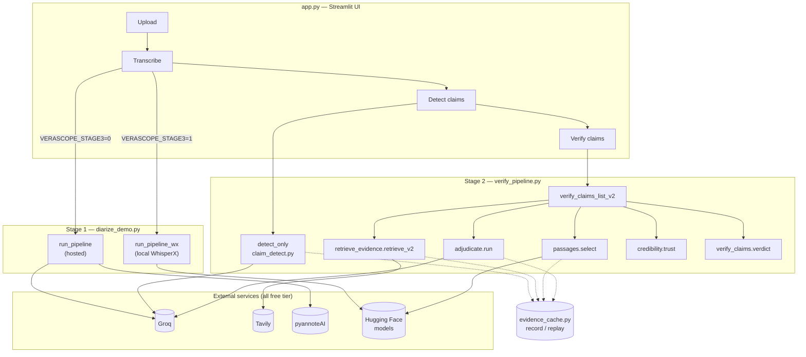

**The one contract between the stages:** Stage 1 emits lines
`(start, end, speaker, text, conf)`, and Stage 2 reads only that. Stage 1 is frozen for
Stage 4 work, so verification changes never touch speech code.

---

## Repository layout

```
VeraScope/
├── app.py                  Streamlit UI (Transcript / Claims tabs, claim cards)
├── flags.py                Shared CLI/UI run-mode flags → env switches
│
│   ── Stage 1: speech ──
├── audio_prep.py           ffmpeg → 16 kHz mono FLAC, chunk planner + splitter (hosted path)
├── transcribe.py           Groq whisper-large-v3-turbo, concurrent chunks (hosted path)
├── stitch.py               Overlap-seam de-duplication across chunks (hosted path)
├── wx_transcribe.py        WhisperX: VAD → faster-whisper → wav2vec2 alignment (local path)
├── diarize_demo.py         Diarization (pyannoteAI / local pyannote 3.1), fusion,
│                           run_pipeline (hosted) and run_pipeline_wx (local), CLI
│
│   ── Stage 2: fact-checking ──
├── claim_detect.py         Groq gpt-oss-20b, strict JSON: claims + 2 search queries each
├── retrieve_evidence.py    Tavily search; v2 = multi-query, one source per website
├── credibility.py          Trust tiers: High 3 / Medium 2 / Low·Unrated 1 points
├── passages.py             Best chunk per source + tier-1 NLI stance
├── adjudicate.py           Tier-2: Groq stance + verbatim-quote check, budgeted
├── verify_claims.py        NLI scoring (local or hosted mDeBERTa) + verdict v2 rules
├── verify_pipeline.py      Stage 2 orchestration, v1 and v2 entry points
├── evidence_cache.py       Record / replay cache for Groq, Tavily, NLI
├── ratings/                Lin et al. 2023 domain-quality ratings (vendored CSV)
│
│   ── Tooling ──
├── make_artifact.py        Save a full run to JSON → replay in the UI with no GPU/API
├── export_claims.py        Batch-export every claim of several recordings to CSV
├── onbox.sh                One-time GPU box setup (whisperx, CUDA, Stage 2 deps)
├── onbox_check.py          Stage 3 acceptance checks on the box
├── time23.py               Stage 1 timing harness (Phase 23)
├── verify_ui_apptest.py    Headless UI check via streamlit.testing (legacy)
├── test_transcribe.py      Legacy hosted-transcription test script
│
├── scripts/check.sh        Offline test runner (pytest, sockets blocked)
├── pytest.ini              testpaths=tests, slow tests deselected
├── tests/                  pytest suite, fixtures, golden replay
│   ├── conftest.py         Session-wide: no keys, no network, no model downloads
│   ├── fixtures/           Recorded cache (cache_audio2/), synthetic_* inputs
│   └── golden/             audio2_v2.json — golden Stage 2 output from replay
│
└── experiments/            Paper benchmark suite
    ├── common.py           Config, resumable records, bootstrap CIs, DER/WER helpers
    ├── speech.py, nli.py   Dataset loaders (AMI, VoxConverse, FEVER) + cached scoring
    ├── e1.py … e9.py       Experiments E1–E9
    ├── averitec.py         E10 data: AVeriTeC dev loader + leakage guard
    ├── e10_items.jsonl     150 sampled AVeriTeC claims with offline evidence
    ├── figures.py          IEEE-style paper figures from results/
    ├── build_notebook.py   Bundles everything into one Colab notebook
    └── aws/                Run the notebook headless on an EC2 GPU
```

---

## Quick start

### 1. Get the code

```bash
git clone https://github.com/Kushal-0532/VeraScope.git
cd VeraScope
python -m venv venv && source venv/bin/activate
```

### 2. Requirements

- Python 3.11, and **`ffmpeg`** on the `PATH`.
- No requirements file. The packages are:

| Use | Packages |
|---|---|
| UI + Stage 2 | `streamlit groq tavily-python python-dotenv huggingface_hub>=1.5 transformers>=5 torch` |
| Hosted Stage 1 | `pyannoteai-sdk librosa soundfile` |
| Local Stage 1 (GPU) | `whisperx` (pins its own torch, so **keep it in a separate venv**), `nvidia-cudnn-cu12` |
| Tests / eval | `pytest scikit-learn` |

`onbox.sh` is the tested install for the GPU box.

| Component | Technologies |
|---|---|
| Language | Python |
| Interface | Streamlit |
| Speech recognition | Whisper (Groq), WhisperX |
| Speaker diarization | pyannoteAI, pyannote 3.1 |
| Language models | Groq API (`openai/gpt-oss-20b`) |
| Evidence retrieval | Tavily API |
| NLI | mDeBERTa-v3 XNLI (local or HF Inference) |
| Audio processing | FFmpeg |

### 3. API keys

Keys are read from `~/.env`. A real environment variable wins over the file.

| Key | Needed for |
|---|---|
| `GROQ_API_KEY` | Hosted transcription, claim detection, tier-2 adjudication |
| `PYANNOTEAI_API_KEY` | Hosted diarization (not needed with `--no-diarize`) |
| `TAVILY_API_KEY` | Evidence search. Without it the **Verify** button is disabled, but transcription still works |
| `HF_TOKEN` | Local diarization (accept the gated `pyannote/speaker-diarization-3.1` and `pyannote/segmentation-3.0` with the same account), and hosted NLI if forced |

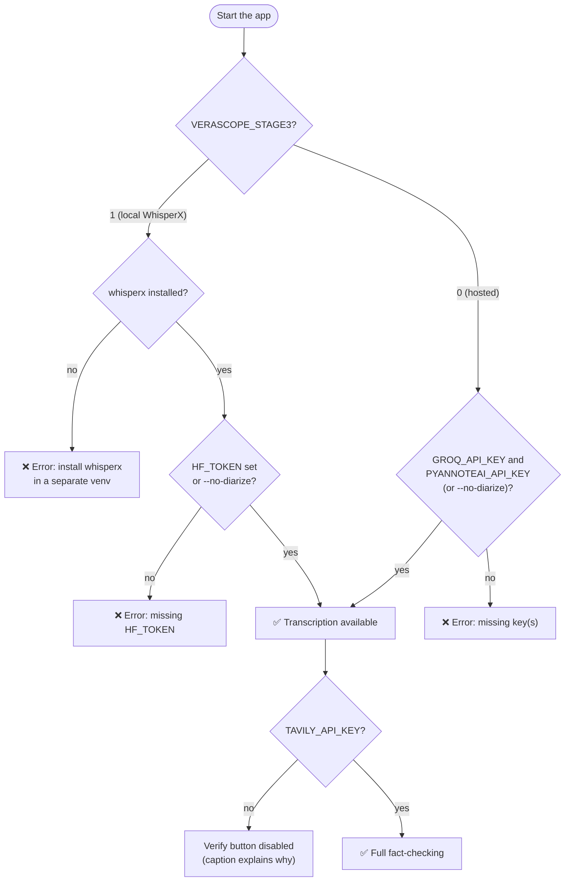

### 4. Run

```bash
streamlit run app.py                                   # hosted Stage 1
VERASCOPE_STAGE3=1 streamlit run app.py                # local WhisperX Stage 1 (GPU)
streamlit run app.py -- --whisperx-offline --whisperx-model tiny --no-diarize   # laptop CPU test
```

Command line, without the UI:

```bash
python diarize_demo.py audio.wav                               # hosted
python diarize_demo.py audio.wav --whisperx-offline            # local WhisperX
python diarize_demo.py audio.wav --whisper-arch medium --no-diarize
```

Most modules also take `--selfcheck`, an offline smoke test with no keys and no network.

---

## Run modes and flags

`flags.py` defines one set of flags shared by the CLI and the UI. Streamlit passes
everything after `--` to the script. Each flag only sets an environment switch that the
pipeline already reads at call time.

| Flag | Env switch | Effect |
|---|---|---|
| `--whisperx-offline` | `VERASCOPE_STAGE3=1` | Local WhisperX + pyannote 3.1 instead of Groq + pyannoteAI |
| `--whisperx-model {tiny,base,small,medium,large-v3}` (alias `--whisper-arch`) | `WHISPERX_ARCH` | WhisperX model size (default `medium`) |
| `--device {cpu,cuda}` | `WHISPERX_DEVICE`, `VERASCOPE_NLI_DEVICE` | Force a device for ASR and NLI |
| `--nli-offline` | `VERASCOPE_LOCAL_NLI=1` | Local mDeBERTa (also the Stage 4 default; `VERASCOPE_LOCAL_NLI=0` forces hosted) |
| `--no-diarize` | `VERASCOPE_NO_DIARIZE=1` | One speaker for the whole file; no model, no API |
| `--record` | `VERASCOPE_CACHE=record` | Cache every external call; replay hits |
| `--replay` | `VERASCOPE_CACHE=replay` | Serve only from cache; a miss raises, never calls out |
| `--refresh` | `VERASCOPE_CACHE=record` + `VERASCOPE_CACHE_REFRESH=1` | Re-call and overwrite cached entries |

Other switches:

| Env var | Default | Meaning |
|---|---|---|
| `VERASCOPE_ARTIFACT` | — | Path to a `*_artifact.json`, which renders a saved run (see below) |
| `VERASCOPE_CACHE_DIR` | `~/.cache/verascope` | Cache location |
| `VERASCOPE_QUERIES` | `2` | Tavily searches per claim |
| `VERASCOPE_TIER2_MAX` | `15` | Tier-2 Groq calls per run |
| `GROQ_TPM` | `8000` | Groq tokens-per-minute pacer |

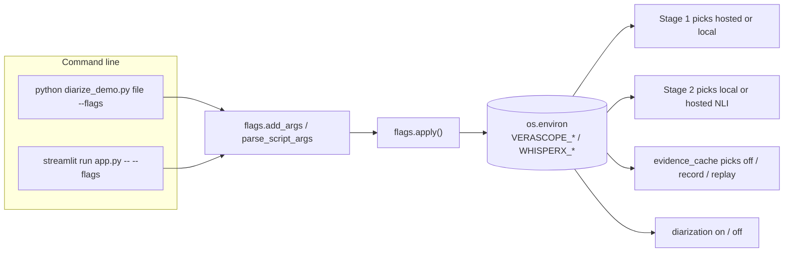

---

## Stage 1: speech to speaker-labelled lines

Both paths end in the same frozen line contract:

```python
lines = [(start_s, end_s, speaker, text, conf), ...]   # time-ordered, conf in [0, 1]
```

### Hosted path: `diarize_demo.run_pipeline`

Groq's audio endpoint caps uploads at 25 MB, so long files are split into overlapping
chunks. The chunks are transcribed concurrently and stitched back together at the seams.
Diarization runs as one job on the whole file, so speaker labels stay consistent from
start to end.

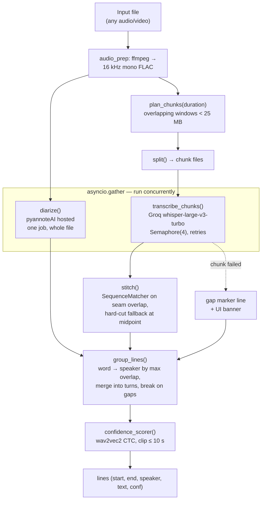

### Local path ("Stage 3"): `diarize_demo.run_pipeline_wx`

WhisperX handles long files natively. Its VAD cuts on silence, so the chunk plan and
the seam stitching aren't needed. Confidence is the wav2vec2 **alignment score**, so
there's no separate confidence pass.

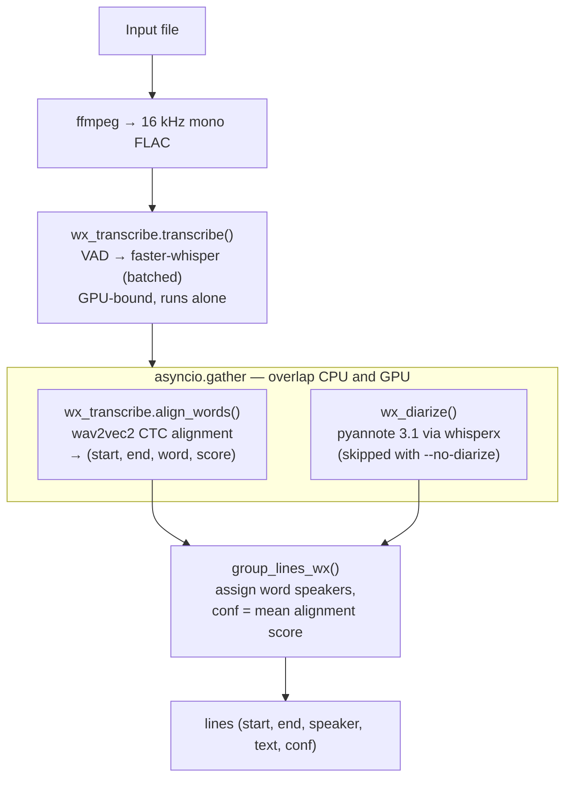

The ordering comes from Phase 23 speed work: ASR runs alone because it is GPU-bound,
and then alignment and diarization overlap. Each stage logs `STAGE <name> <s>s` to
stderr, and `time23.py` and experiment E2 read those lines.

### Path selection

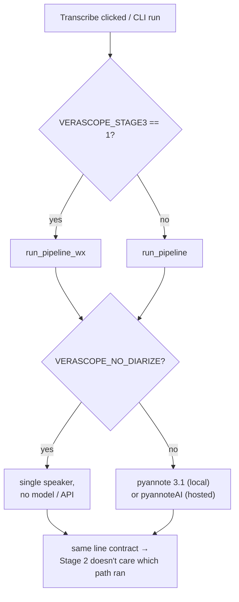

---

## Stage 2: claims to verdicts (v2 pipeline)

Stage 2 is split into a cheap step and an expensive step, so the UI can show claims
right away and only spend search credits when the user asks.

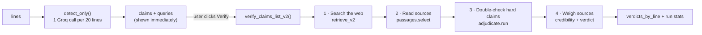

The four steps are what the UI progress box shows: *Searching the web… → Reading
sources… → Double-checking hard claims… → Weighing sources…*

### Step 0: claim detection (`claim_detect.py`)

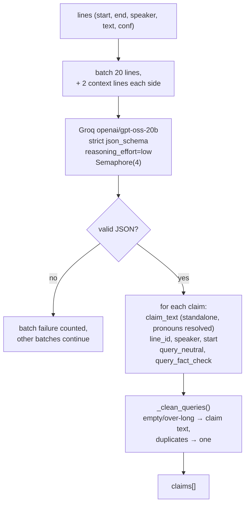

One sentence can hold several claims; each one is decomposed and checked
independently. The two search queries come out of the **same** call, so there are no
extra Groq requests.

### Step 1: evidence retrieval (`retrieve_evidence.retrieve_v2`)

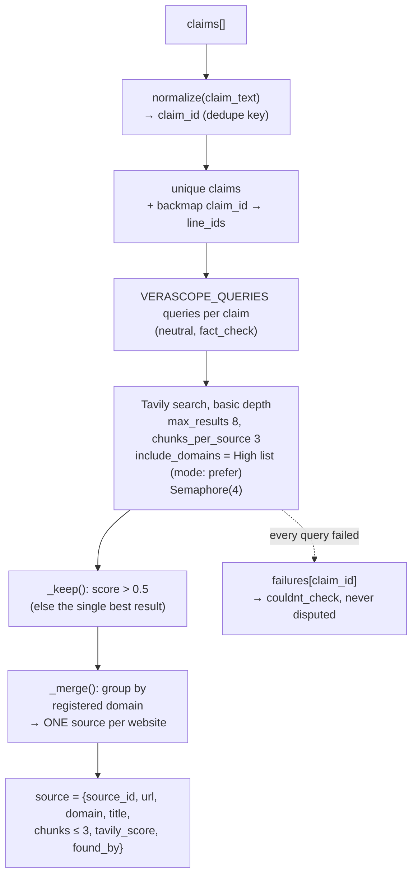

Keeping one source per website means a site that shows up in both searches still gets
only one vote.

### Trust tiers (`credibility.py`)

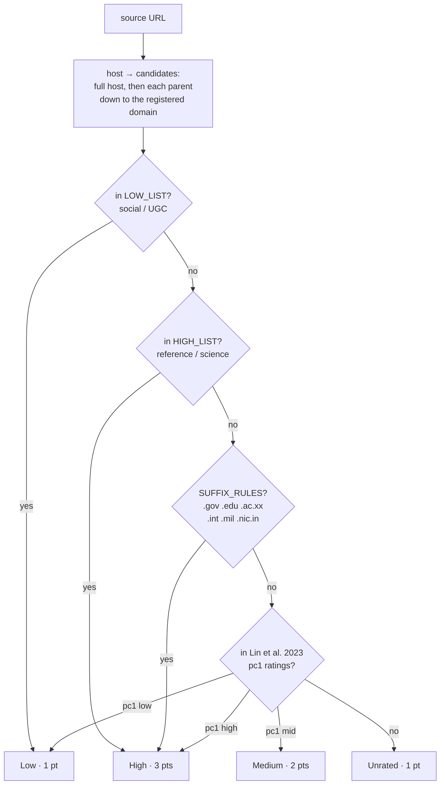

The first match wins, in this order: `LOW_LIST > HIGH_LIST > SUFFIX_RULES > rating >
Unrated`. Every tier comes with a human-readable `trust_reason`, which the UI shows.

### Step 2: best passage + tier-1 stance (`passages.py`)

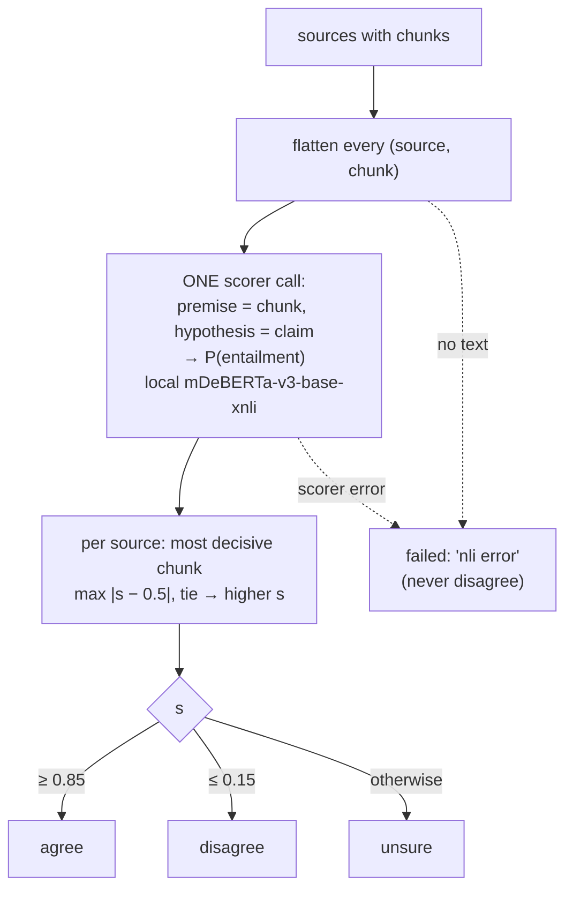

### Step 3: tier-2 adjudicator (`adjudicate.py`)

Hard claims get one more look, from an LLM that has to quote its source verbatim.

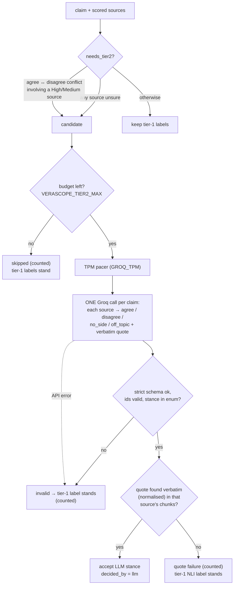

Claims are processed in line order, so if the budget runs out, the earliest claims in the
recording get the tier-2 check.

### Step 4: verdict (`verify_claims.verdict`)

Only `agree` and `disagree` vote, weighted by trust points.
`share = agree_points / (agree_points + disagree_points)`.

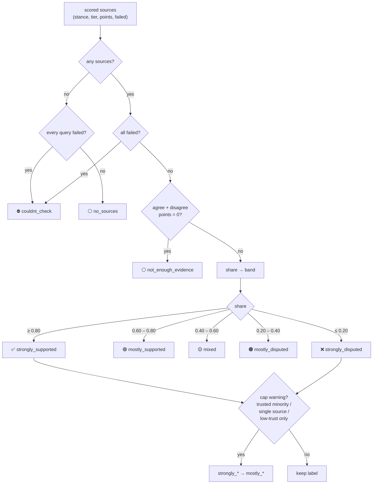

Warnings shown under the label:

| Key | Text | Caps "strongly"? |
|---|---|---|
| `trusted_minority` | "A highly trusted source disagrees / agrees" | yes |
| `single_source` | "Only one source took a side" | yes |
| `low_trust_only` | "Only low-trust sources took a side" | yes |
| `partial_failures` | "2 of 5 couldn't be read" | no |

### The v2 record (data contract)

Every line a claim was said on gets the **same** record object (`schema_version: 2`):

```json
{
  "schema_version": 2,
  "claim_id": "first graders were doing 28 minutes of homework",
  "claim_text": "First graders were doing 28 minutes of homework.",
  "occurrences": [{"line_id": 7, "speaker": "SPEAKER_01", "start": 49.2}],
  "label": "mostly_supported", "emoji": "🟢", "label_text": "Mostly supported",
  "share": 0.667, "agree_points": 6, "disagree_points": 3,
  "warnings": [{"key": "single_source", "text": "Only one source took a side"}],
  "counts": {"agree": 2, "disagree": 1, "no_side": 5, "off_topic": 1, "failed": 0},
  "sources": [{"source_id": 1, "url": "…", "domain": "…", "chunks": ["…"],
               "best_chunk": "…", "nli_score": 0.93, "tier1": "agree",
               "stance": "agree", "decided_by": "nli", "tier": "High",
               "points": 3, "trust_reason": "list: reference/science"}],
  "summary": null
}
```

Run stats (shown in the UI's "Run stats" expander): `n_lines`, `n_claims`,
`n_unique_claims`, `label_counts`, `tavily_credits`, `groq_calls {detect, tier2, summary}`,
`tier2_skipped`, `quote_failures`, `nli_pairs`, `cache {hits, misses, writes}`, and
`elapsed` per step.

### Failure handling, end to end

**A failure is never a dispute.** Each failure lowers coverage. None of them is
counted as "disagree".

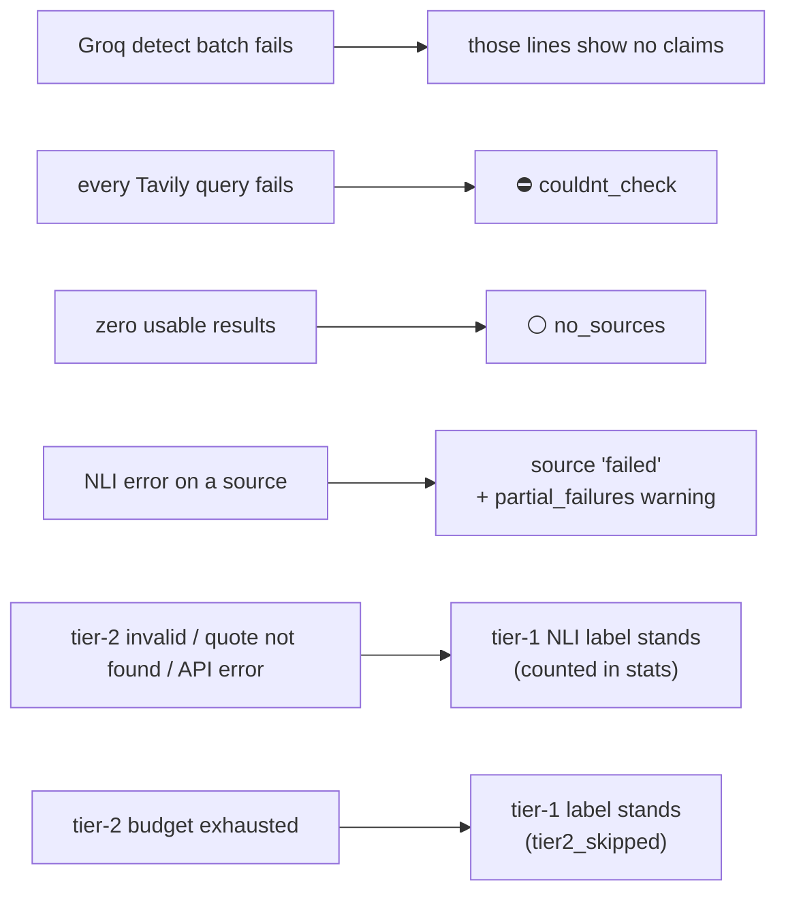

---

## Verdict labels

| Label | Shown as | When |
|---|---|---|
| `strongly_supported` | ✅ Strongly supported (share · points) | share ≥ 80 %, no cap warning |
| `mostly_supported` | 🟢 Mostly supported | 60–80 %, or strongly with a cap warning |
| `mixed` | 🟡 Mixed | 40–60 % |
| `mostly_disputed` | 🟠 Mostly disputed | 20–40 %, or strongly with a cap warning |
| `strongly_disputed` | ❌ Strongly disputed | ≤ 20 %, no cap warning |
| `not_enough_evidence` | ⚪ Not enough evidence | sources found, none took a side |
| `no_sources` | ⚪ No sources found | search returned nothing usable |
| `couldnt_check` | ⛔ Couldn't check | every search failed, or every source failed. *Says nothing about whether the claim is true* |
| `not_checked` | ⏳ Not checked yet | UI only: detected but not verified |

Labels without a share don't show a percentage.

---

## The Streamlit UI

Layout: **settings sidebar** on the left (language hint, speaker range, line-break gap,
low-confidence threshold, WhisperX model size, active test modes), the **audio player**
in the left column, and **Transcript | Claims** tabs on the right.

### User workflow

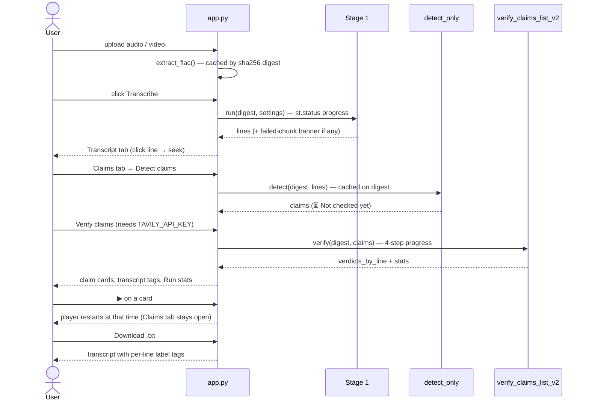

### Caching inside the UI

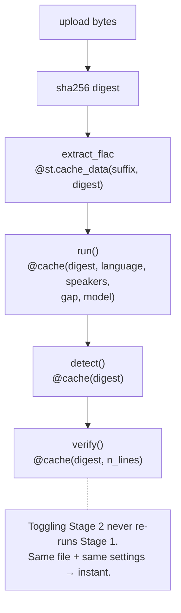

### Claim card anatomy

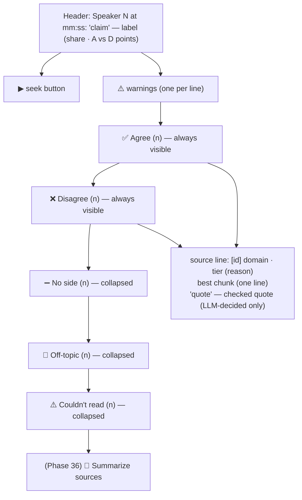

**Seeking:** the buttons set `seek` in an `on_click` callback, so there's no rerun, and
the tabs are tracked with `key="view"`, so the Claims tab stays open. A `seek_n` counter
makes every click create a fresh player, so the same time can be replayed. `st.audio`
truncates `start_time` to whole seconds.

---

## Record / replay cache

`evidence_cache.py` wraps **every** external call: Groq, Tavily and NLI. One JSON file
is stored per key, under `<VERASCOPE_CACHE_DIR>/<kind>/<key[:2]>/<key>.json`.

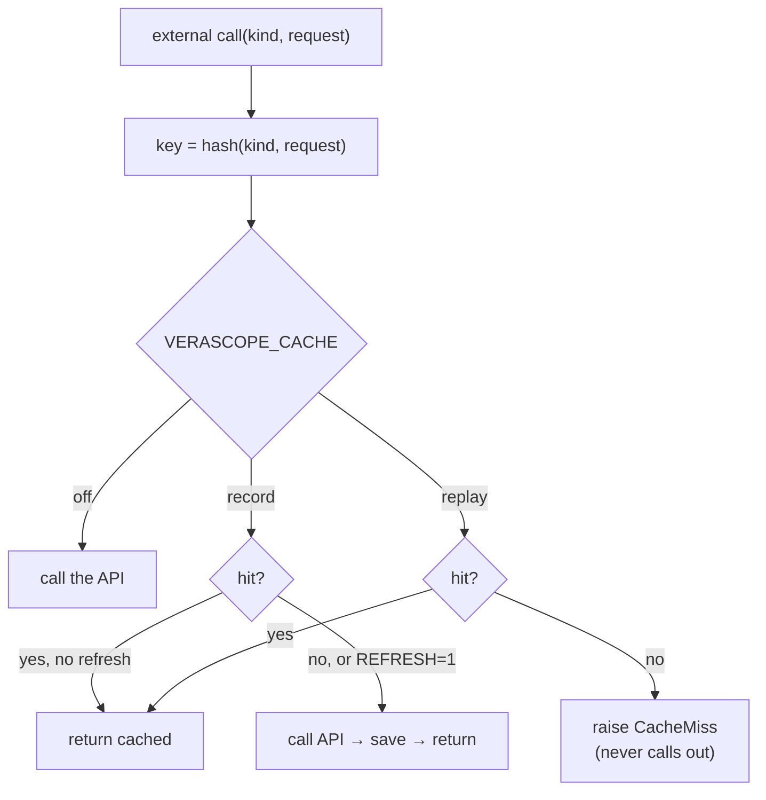

`get_many()` caches per item (for example per NLI pair) and makes **one** batched call
for only the misses. The golden test replays `tests/fixtures/cache_audio2` through the
whole v2 pipeline offline.

---

## Demo artifacts (no GPU, no API)

`make_artifact.py` runs Stage 1 and Stage 2 once and saves everything the UI needs.
The UI can then render the run on any laptop.

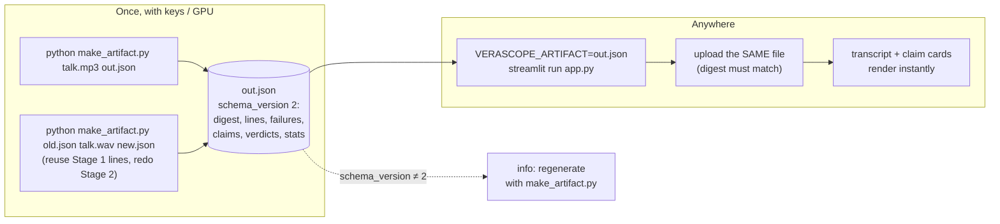

`export_claims.py rec1.wav rec2_artifact.json -o claims.csv` writes one CSV row per
(claim, line) pair for manual labelling. It reuses artifacts, so no credits are spent
a second time.

---

## Testing

```bash
scripts/check.sh                          # full offline suite (218 tests)
scripts/check.sh tests/test_verdict_v2.py # one file
python -m pytest -m slow                  # model-backed tests (cached model / GPU)
python verify_claims.py --selfcheck       # per-module offline smoke tests
```

```mermaid
flowchart TB
    CS["scripts/check.sh"] --> PY["pytest -q (testpaths=tests, -m 'not slow')"]
    PY --> CF["conftest.py (session, autouse)"]
    CF --> K["strip API keys,<br/>VERASCOPE_* / WHISPERX_* switches"]
    CF --> N["block sockets<br/>→ 'network blocked in tests'"]
    CF --> H["HF_HUB_OFFLINE=1,<br/>TRANSFORMERS_OFFLINE=1"]
    CF --> E["scrubbed_env(home) for subprocesses<br/>(HOME redirected so ~/.env can't restore keys)"]
    PY --> T["tests use fake Groq / Tavily / scorer,<br/>recorded fixtures, or cache replay"]
    T --> G["golden: replay cache_audio2 →<br/>compare with golden/audio2_v2.json"]
```

| Test file | Covers |
|---|---|
| `test_network_guard.py` | The socket block really blocks |
| `test_flags_app.py` | Flags → env switches; UI test modes |
| `test_evidence_cache.py` | off / record / replay / refresh, `get_many` batching |
| `test_claim_detect_queries.py` | Query generation + cleaning |
| `test_retrieve_v2.py` | Multi-query merge, one source per domain, failures |
| `test_credibility.py` | Tier precedence, ratings, High-domain list |
| `test_passages.py` (+ `_slow`) | Best chunk, thresholds, failure ≠ disagree |
| `test_adjudicate.py` | Trigger rule, budget, quote check, pacer |
| `test_verdict_v2.py` | Bands, caps, warnings, edge cases |
| `test_pipeline_v2.py` | Wiring, fan-out to lines, stats, golden replay |
| `test_ui_cards.py` | Claim cards via `streamlit.testing.AppTest`, seek behaviour |
| `test_averitec.py` | AVeriTeC loader, sampler, leakage guard |
| `test_selfchecks.py` | Every module's `--selfcheck` |

Fixture rule: fixtures are **recorded** by a live run and never hand-written. The only
exception is tiny synthetic inputs, which must be named `synthetic_*`.

### Re-recording the golden test

```mermaid
flowchart LR
    A["VERASCOPE_CACHE=record<br/>make_artifact.py audio2_artifact.json audio2.wav"] --> B["copy cache →<br/>tests/fixtures/cache_audio2"]
    B --> C["replay run → regenerate<br/>tests/golden/audio2_v2.json"]
    C --> D["scripts/check.sh"]
```

---

## GPU box (AWS)

Local WhisperX needs an NVIDIA GPU. The setup used is an AWS Deep Learning AMI on a
g5.xlarge (A10G) or g4dn.xlarge (T4).

```mermaid
flowchart TB
    L["launch g5.xlarge / g4dn.xlarge<br/>(Deep Learning AMI, CUDA torch)"] --> CP["copy repo + ~/.env"]
    CP --> OB["bash onbox.sh<br/>venv (system site-packages),<br/>whisperx, streamlit, groq, tavily,<br/>hf_hub ≥ 1.5, transformers ≥ 5,<br/>nvidia-cudnn-cu12"]
    OB --> VC["prints versions, GPU,<br/>'stage 2 ok' import check"]
    VC --> CK["python onbox_check.py<br/>(Stage 3 acceptance checks)"]
    CK --> RUN["VERASCOPE_STAGE3=1 streamlit run app.py<br/>(SSH tunnel to :8501)"]
    RUN --> ART["make_artifact.py → copy JSON home"]
    ART --> STOP["⚠️ stop the instance"]
```

Measured Stage 1 time on the 48:46 demo file: **289.9 s on a T4, 96.4 s on an A10G**
after the Phase 23 reordering.

---

## Experiments (paper)

`experiments/` is a benchmark suite. It calls **the repo's own pipeline code**
on public data, so it measures what actually ships.

| ID | Question | Data |
|---|---|---|
| E1 | Chunked vs whole-file diarization (DER) | AMI, VoxConverse |
| E2 | Stage 1 latency vs duration, per stage | AMI dev (concatenated) |
| E3 | WhisperX WER, overlap vs non-overlap | AMI test |
| E4 | NLI threshold sweep + calibration | FEVER |
| E5 | Verdict aggregation under retrieval noise | FEVER |
| E6 | Claim detection vs context window | ClaimBuster |
| E7 | Claim dedup on own videos (optional) | user recordings |
| E8 | Hosted vs local Stage 1 (optional) | AMI test |
| E9 | Gemma audio diarization: zero-shot vs QLoRA | AMI windows |
| E10 | v2 ablation on AVeriTeC (**skipped**; data loader only) | AVeriTeC dev |

Results from the full run (25 Sep 2026):
- **E1:** whole-file pyannote 3.1 DER is **9.3 %** over 26 files, against **52.4 %** when 600 s chunks are diarized separately.
- **E3:** WhisperX WER is **24.2 %** with medium and **23.8 %** with large-v3, on 16 AMI test meetings.
- **E4:** NLI verdict macro-F1 is **0.694** at the app's 0.85 / 0.15 thresholds, on 1,500 held-out FEVER claims.
- **E6, E7, E8:** no results.
- **E9:** the fine-tuned model scored worse than zero-shot (DER 0.45 vs 0.39). That needs investigating before it goes in the paper.

### Running the suite

```mermaid
flowchart TB
    CODE["repo modules + experiments/*.py"] --> BN["python3 experiments/build_notebook.py"]
    BN --> NB[("experiments/notebooks/<br/>verascope_experiments.ipynb<br/>(code embedded as base64 zip)")]
    NB --> C1{where?}
    C1 -- "Colab (free T4)" --> COL["open notebook,<br/>secrets: HF_TOKEN, GROQ_API_KEY"]
    C1 -- "AWS GPU" --> AWS["experiments/aws/aws_run.sh up<br/>(L4 → A10G → T4 fallback, papermill)"]
    COL & AWS --> SM{SMOKE}
    SM -- "1 (default)" --> RS["results_smoke/ — tiny, quick"]
    SM -- "0" --> RF["results/ — full run,<br/>resumable per item"]
    RF --> FIG["python -m experiments.figures<br/>→ figures/*.pdf, *.png,<br/>captions_draft.md"]
    AWS --> FT["aws_run.sh fetch<br/>(download + stop the box)"]
```

`aws_run.sh` subcommands: `check` (HF access, HTTP codes only), `up`, `rerun` (after a
code fix, finished items are skipped), `status`, `watch`, `fetch`. Secrets come from
`~/.verascope_secrets`.

### E10 data (AVeriTeC)

```mermaid
flowchart LR
    HF[("HF: chenxwh/AVeriTeC<br/>dev.json + dev_top_k_sentences.json")] --> LD["load_dev()<br/>500 claims, label map,<br/>unknown label → error"]
    LD --> SA["sample(seed 42)<br/>40 supported / 50 refuted /<br/>30 conflicting / 30 NEI"]
    SA --> LF["leak_filter() per sentence<br/>(unwrap web.archive.org):<br/>own fact-check URL + domain,<br/>claim URLs"]
    LF --> EP["evidence_pool()<br/>one source per domain,<br/>≤ 10 × 3 sentences"]
    EP --> OUT[("e10_items.jsonl<br/>150 items, Phase 30 shape")]
```

---

## Free-tier budgets

Everything is designed for free tiers. The limits are enforced in code.

| Service | Limit | Where it's enforced |
|---|---|---|
| Groq `gpt-oss-20b` | 30 RPM, 1K RPD, 8K TPM | `GROQ_TPM` pacer, `VERASCOPE_TIER2_MAX` (15/run), batched detection (20 lines/call) |
| Tavily | monthly credits, 1 per basic search | `VERASCOPE_QUERIES` (2/claim), claim dedupe, cache |
| HF Inference | credits (currently exhausted) | local NLI is the default |
| pyannoteAI | credits (currently exhausted) | `--no-diarize`, or local pyannote |

```mermaid
flowchart LR
    A["N lines"] --> B["⌈N/20⌉ Groq calls<br/>(detect + queries)"]
    B --> C["M unique claims"]
    C --> D["≤ 2·M Tavily credits"]
    C --> E["NLI: local, free"]
    C --> F["≤ 15 Groq tier-2 calls"]
    D & F --> G["--record once,<br/>--replay forever: 0 credits"]
```

---

## Development workflow

The project is built with **spec-driven development**. Specs live in the parent repo
(`capstone_project/specs/`) and are not in this repo:

- `SPEC.md`: goals in EARS form, Prior Decisions, Open Questions, and a per-stage Constitution
- `PHASES.md`: the phase table (Stage 1: 0–9, Stage 2: 10–15, Stage 3: 16–23, Stage 4: 24–40), with a completion log
- `phases/NN-*.md`: one file per phase with scope, EARS acceptance criteria, `Verify` commands and notes
- `docs/`: focused library extracts

```mermaid
flowchart TB
    P["pick next phase<br/>(first 🔄, else first 🔲)"] --> PF{"deps ✅ and<br/>no blocking question?"}
    PF -- no --> BL["⛔ blocked → ask"]
    PF -- yes --> CL["claim: 🔄, Attempts += 1"]
    CL --> IM["implement in scope,<br/>follow Constitution"]
    IM --> VR["run Verify commands<br/>(scripts/check.sh …)"]
    VR -- fail --> FX["fix (≤ 3 rounds)"] --> VR
    VR -- pass --> RV["independent reviewer<br/>(fresh context)"]
    RV -- fail --> FX
    RV -- PASS --> GT{"Gate"}
    GT -- auto --> DONE["✅ done, notes, commit"]
    GT -- human --> HU["🟡 awaiting human check"]
    HU -- "phase N done" --> DONE
    DONE --> CLR["/clear → next phase"]
```

Stage 4 Constitution, in short:

1. Every phase adds tests.
2. `check.sh` is offline.
3. No LLM output reaches a verdict unvalidated.
4. A failure is never a dispute.
5. Budgets are enforced in code.
6. Stage 1 is frozen.
7. No new runtime dependency.
8. Paste real output; never fake a number.

This repo was started on 25 Sep 2026 from a copy of `capstone_project/`. That repo's
git history (22 Aug – 9 Sep 2026) holds the early development log.

---

## Known limitations

VeraScope is an experimental fact-checking tool. Its results depend on transcription
accuracy, speaker identification, language-model outputs and the relevance of the
evidence it retrieves. **Review each verdict alongside its sources. Don't treat it as a
definitive conclusion.**

- **Timestamp jitter:** seeking can be off by ±0.5 s per line (worst case about 3 s),
  because Whisper's segment timing isn't exact. `st.audio` also truncates to whole
  seconds. Sub-second seeking would need a custom player.
- **Trust by registered domain:** `britannica.com` is High, so are its quiz and
  `procon.` subdomains. Tiering by host is a candidate fix.
- **Syndication:** one vote per website doesn't catch the same wire story on many
  sites.
- **Hosted Stage 1 still in the repo:** removing it (Phase 19) is the last Stage 3
  cleanup.
- **No labelled real-audio benchmark** for verdict accuracy. E4 and E5 measure the
  NLI step on FEVER, not the full v2 pipeline.

---

## Future scope

- Improve transcription and diarization accuracy.
- Expand multilingual support.
- Enhance claim detection and evidence retrieval.
- Improve verification reliability and processing efficiency.
- Cited source summaries on each claim card (Phase 36).

---

## Data and licences

- **Domain ratings:** `ratings/domain_pc1.csv` is from Lin et al. 2023 (*PNAS Nexus*),
  vendored unmodified (see `ratings/README.md`; the source repo has no licence file,
  so it is used for research).
- **AVeriTeC:** Schlichtkrull et al. 2023, CC BY-NC 4.0 (non-commercial).
- **AMI, VoxConverse, FEVER, ClaimBuster:** used under their respective licences, for
  evaluation only.
- **NLI model:** `MoritzLaurer/mDeBERTa-v3-base-xnli-multilingual-nli-2mil7`.
- **Diarization:** `pyannote/speaker-diarization-3.1` (gated; accept the terms on
  Hugging Face).
